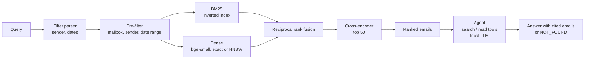

# local-recall

A personal search engine that runs fully on a laptop, with every stage measured.

It searches a person's own documents (here: email) with keyword search, embedding search, a fusion of the two and a re-ranking model, and puts a small tool-calling agent on top that answers questions and cites the emails it used. No text leaves the machine: the embedding model, the re-ranker and the language model all run locally.

The point of the project is the measurement. Each stage is compared against the one before it on public benchmarks, with confidence intervals and paired significance tests, and the results include the stages that did not help.

## What I found

1. **No single retriever wins everywhere.** Dense retrieval beats BM25 by 0.16 nDCG@10 on financial questions (FiQA), but on questions about a mailbox BM25 beats dense by 0.05 MRR@10. People ask about email using the words that are in the email.
2. **Hybrid fusion is not free.** Reciprocal rank fusion is the best system on NFCorpus (+0.022 over dense), no different from dense on SciFact, and clearly worse than dense on FiQA (-0.048), where BM25 is weak and equal-weight fusion drags the result down.
3. **The re-ranker helps where its training data looks like the task.** A cross-encoder trained on web search queries adds +0.029 MRR@10 on mailbox questions but shows no clear gain on scientific or medical text. It also costs about 1.4 seconds per query on the CPU for 50 candidates, against under 25 ms for everything before it.
4. **Structured filters matter more than the ranker.** Hiding emails dated after the question is worth +0.059 MRR@10 on the mailbox benchmark, more than fusion or re-ranking. It moved the right email to rank 1 for 132 questions.
5. **Int8 quantization is close to free for quality.** The quantized embedding model is 34 MB instead of 133 MB, and the nDCG@10 change is inside the noise on both datasets tested (-0.005 and -0.003, confidence intervals include zero). Moving from PyTorch to ONNX Runtime is the larger speed win: about 3 times faster per query.
6. **Approximate search is not needed at this scale.** HNSW reaches 0.975 recall of the exact top 10 at 0.2 ms on 57,638 documents, but exact search is already 1.7 ms. For one person's data, exact search plus a pre-filter is simpler and has no recall loss.

7. **With a small on-device model, the agent loop did not pay off.** Using a 1.5B-parameter model, multi-step tool use cites a correct source email about as often as retrieving once and answering (0.613 against 0.640, the difference is inside the noise), gives worse answers (token F1 0.255 against 0.454) and takes four times longer (7.6 s against 1.9 s). When the source emails are removed, it admits it cannot answer only 19% of the time, against 52% for the single step. The retriever is not the bottleneck: the right email is in the top 5 for 96% of questions. The reader is.

## How it works



| Stage | What it is | File |
|---|---|---|
| Tokenizer | Unicode folding, stopwords, plural-only stemmer | `src/local_recall/tokenizer.py` |
| BM25 | Inverted index and scoring written from scratch, checked against `rank_bm25` | `src/local_recall/bm25.py` |
| Dense | `BAAI/bge-small-en-v1.5` (33M parameters, 384 dimensions), exact search and FAISS HNSW | `src/local_recall/dense.py` |
| Fusion | Reciprocal rank fusion, k = 60 | `src/local_recall/fusion.py` |
| Re-ranking | `cross-encoder/ms-marco-MiniLM-L-6-v2` over the top 50 | `src/local_recall/rerank.py` |
| Query understanding | Rule-based parser for sender and date filters | `src/local_recall/query_filters.py` |
| Engine | One object for all modes, filters applied before ranking | `src/local_recall/engine.py` |
| On-device formats | ONNX export and int8 dynamic quantization | `src/local_recall/benchmark.py` |
| Agent | Tool loop on a local model, with grounding rules enforced in code | `src/local_recall/agent.py` |
| Metrics and statistics | nDCG, recall, MRR, bootstrap intervals, paired randomization test, Holm correction | `src/local_recall/metrics.py`, `stats.py` |

## Results

All numbers below are copied from [`results/RESULTS.md`](results/RESULTS.md) and [`results/analysis.json`](results/analysis.json), which are generated from the result files in `results/`. Brackets are 95% bootstrap confidence intervals over queries. Latency was measured on an Intel Core i7-13620H laptop CPU, one query at a time.

### Retrieval quality on three BEIR test sets (nDCG@10)

| System | SciFact (300 queries, 5,183 docs) | NFCorpus (323 queries, 3,633 docs) | FiQA (648 queries, 57,638 docs) |
|---|---|---|---|
| BM25, no stemming | 0.666 [0.619, 0.712] | 0.307 [0.274, 0.341] | 0.238 [0.214, 0.263] |
| BM25 | 0.666 [0.620, 0.712] | 0.321 [0.287, 0.355] | 0.242 [0.218, 0.267] |
| Dense (exact) | 0.713 [0.668, 0.755] | 0.344 [0.309, 0.378] | 0.403 [0.375, 0.432] |
| Hybrid (RRF) | 0.709 [0.664, 0.752] | 0.366 [0.330, 0.401] | 0.355 [0.328, 0.382] |
| Hybrid + cross-encoder | 0.693 [0.648, 0.737] | 0.356 [0.321, 0.391] | 0.374 [0.347, 0.401] |

The intervals of neighbouring systems overlap, which is why the comparisons are paired: both systems are scored on the same queries and the test looks at the per-query differences. The full table of paired tests is in `results/RESULTS.md`, section 3. Two examples of why this matters:

- On SciFact, dense is +0.047 over BM25 and the interval of the difference excludes zero, but after correcting for the nine comparisons made on that dataset the p-value is 0.078. I report it as "no clear difference".
- On FiQA, the cross-encoder is +0.018 over plain hybrid with a corrected p-value of 0.081. Same verdict.

### Personal search: questions about one mailbox

1,733 questions over 8 Enron mailboxes (24,601 emails after removing duplicates). Each question belongs to one mailbox owner and has a date. The search sees only that mailbox, and only emails up to that date.

| System | Recall@1 | Recall@5 | Recall@10 | MRR@10 |
|---|---|---|---|---|
| BM25 | 0.752 [0.734, 0.770] | 0.960 [0.950, 0.968] | 0.975 [0.968, 0.982] | 0.894 [0.882, 0.906] |
| Dense (exact) | 0.693 [0.673, 0.712] | 0.919 [0.907, 0.930] | 0.950 [0.940, 0.960] | 0.844 [0.830, 0.858] |
| Hybrid (RRF) | 0.744 [0.725, 0.762] | 0.956 [0.947, 0.965] | 0.977 [0.970, 0.983] | 0.892 [0.880, 0.904] |
| Hybrid + cross-encoder | 0.787 [0.770, 0.804] | 0.963 [0.955, 0.971] | 0.981 [0.975, 0.987] | 0.921 [0.911, 0.932] |
| Hybrid, no date filter | 0.681 [0.661, 0.701] | 0.908 [0.895, 0.921] | 0.942 [0.931, 0.952] | 0.834 [0.819, 0.848] |

### Agent against single-step retrieval

Same local model (`Qwen/Qwen2.5-1.5B-Instruct`), same retriever (hybrid + cross-encoder, top 5), 150 questions sampled with a fixed seed. For 75 of them a second run hides the source emails, where the right behaviour is to say NOT_FOUND.

| System | Cites a gold email | Answer F1 | Says NOT_FOUND, evidence present | Says NOT_FOUND, evidence removed | Model calls | Seconds |
|---|---|---|---|---|---|---|
| Single-step | 0.640 [0.560, 0.713] | 0.454 [0.400, 0.509] | 0.067 [0.027, 0.107] | 0.520 [0.400, 0.627] | 1.0 | 1.9 |
| Agent (search and read tools, up to 6 steps) | 0.613 [0.533, 0.693] | 0.255 [0.212, 0.300] | 0.153 [0.100, 0.213] | 0.187 [0.107, 0.280] | 4.5 | 7.6 |

Paired differences, agent minus single-step: citation -0.027 [-0.127, +0.073], p = 0.695. Answer F1 -0.199 [-0.261, -0.137], p < 0.001. NOT_FOUND with evidence removed -0.333 [-0.467, -0.200], p < 0.001.

What the transcripts show:

- **The model wants to answer from previews.** In 150 episodes the loop sent back 180 answers that were given before any email had been opened. Without that rule in code, most citations would rest on a two-line preview.
- **The two systems fail on different questions.** Both cite a gold email on 64 questions, only the agent on 28, only the single step on 32. The agent recovers some questions by searching with its own keywords and loses others by opening the wrong email.
- **Longer answers, lower F1.** The agent's answers have a median of 20 words against 10 for the single step, and it tends to summarise the email it opened instead of answering the question asked.
- **More steps, more chances to find something that looks like an answer.** With the evidence removed, the agent keeps searching until a related email turns up and then answers from it. This is the result I would worry about most in a product.
- **Invented filters are real.** The model added a sender or date filter in 16 of 153 searches, and in 8 of those the filter matched nothing and the fallback to an unfiltered search was used.

This is one small model. The comparison says that a multi-step loop is not automatically better and has to earn its latency, not that agents do not work. Repeating it with larger models is the first item on the to-do list.

### On-device cost

| Embedding model format | File size | Embed one query, p50 (SciFact / NFCorpus) | nDCG@10 (SciFact / NFCorpus) |
|---|---|---|---|
| PyTorch fp32 | n/a | 20.8 ms / 14.4 ms | 0.713 / 0.344 |
| ONNX fp32 | 133.1 MB | 6.4 ms / 4.8 ms | 0.713 / 0.344 |
| ONNX int8 (dynamic quantization) | 34.1 MB | 5.6 ms / 3.8 ms | 0.707 / 0.341 |

| Step, FiQA (57,638 docs) | p50 | p95 |
|---|---|---|
| BM25 search, top 100 | 0.6 ms | 1.3 ms |
| Embed query (PyTorch fp32) | 17.5 ms | 20.3 ms |
| Exact vector search | 1.7 ms | 2.3 ms |
| HNSW search, ef = 64 (0.975 recall of exact top 10) | 0.2 ms | 0.3 ms |
| Cross-encoder, 50 candidates | 1,279 ms | 1,307 ms |

Index size for FiQA: 30.9 MB of BM25 postings, 88.5 MB of embeddings, 104.2 MB for the HNSW graph.

## Error analysis

Mailbox benchmark, looking at where the right email was ranked:

- **BM25 right, dense far off (61 questions).** Questions with a specific name, number or rare term: "What is the phone number for Mark on the weather desk?", "When is the EIM all employee meeting and happy hour?". One vector for a whole email blurs a single detail. Exact term match does not.
- **Dense right, BM25 far off (20 questions).** Broader questions with common words, where meaning matters more than a rare term: "What did the California governor say about meeting with power generators?", "What is the main concern Jeff has about California's regulation of utility purchases?".
- **Re-ranker.** It moved the right email to rank 1 for 150 questions and pushed it down from rank 1 for 72. A net gain, not a free one.
- **Still missed after everything (23 questions).** For 7 of them the email was outside the top 10 of both first-stage retrievers. For the other 16, at least one retriever had it in its top 10 and fusion or the re-ranker pushed it out. So most remaining errors are ranking errors, not recall errors.
- **FiQA, where fusion hurts.** BM25 reaches 0.242 against 0.403 for dense. Reciprocal rank fusion gives both lists the same weight, so a weak list pulls good dense results down. A weight learned on held-out queries, or a rule that falls back to dense when the two lists disagree strongly, is the obvious next experiment.

## Design decisions

- **BM25 from scratch.** The index is about 100 lines. Writing it made the tokenizer choices explicit and testable, and the test suite checks the scores against the `rank_bm25` library to five decimal places.
- **A plural-only stemmer, and a measurement of it.** A simple stemmer gave +0.014 nDCG@10 on NFCorpus and nothing measurable on SciFact or FiQA. I kept it because it never hurt, and because every rule fits in ten lines.
- **Rank fusion over score fusion.** BM25 scores and cosine similarities live on different scales. Reciprocal rank fusion needs no calibration and has one parameter. The FiQA result shows its limit.
- **Filter first, then rank.** Mailbox, sender and date filters select the candidate set, and the rankers only score that set. Filtering after an approximate search can return too few results. Filtering first is exact, and one person's data is small enough to afford it.
- **A rule-based filter parser that refuses to guess.** A wrong hard filter hides the right answer completely. The parser only acts on patterns it is sure about ("emails from greg whalley in June 2000") and leaves "Avi from Mars Corp." alone. The same lesson came back with the agent, which invented sender filters, so a filter that matches nothing falls back to an unfiltered search and says so.
- **Grounding rules in code.** A 1.5B-parameter model does not follow "read before you answer" reliably. The loop enforces it: an email can be cited only after its full text was shown, and an answer given before any email was opened is sent back.
- **Automatic scores only.** The agent is scored on whether it cites a gold source email and on token overlap with the reference answer. No language model judges another.
- **Greedy decoding and fixed seeds.** Every table can be regenerated.

## Limitations

- **The mailbox questions are synthetic.** They were written by a language model from the source emails, so they share words with the email more than real questions would. This favours BM25 and probably overstates every system. The dataset gives a realism score for each question, but I did not filter on it.
- **The mailbox task is small.** The benchmark's question dates fall early in each mailbox, so a search sees 436 emails on average (at most 1,135). The run without the date filter searches whole mailboxes of 2,200 to 10,752 emails.
- **One vector per email.** Bodies are cut at 6,000 characters for storage and the embedding model reads at most 512 tokens. Long emails are only partly seen by the dense retriever and the re-ranker.
- **No tuning.** BM25 uses k1 = 1.2 and b = 0.75, fusion uses k = 60, the re-ranker reads 50 candidates. None of these was tuned, on any split. The numbers are a fair default, not a ceiling.
- **English only**, and three BEIR sets out of eighteen. The ONNX comparison covers the two small sets.
- **Zero-shot is not guaranteed.** The embedding model and the re-ranker were trained by their authors on large public collections. I did not check those for overlap with the test sets.
- **Latency is from one laptop.** Bulk encoding and the mailbox and agent runs used the laptop GPU to save time. Every latency number in the tables is from the CPU.
- **Answer F1 is a rough score.** A correct answer in different words scores low. Source citation is the more reliable agent metric.
- **The filter parser has unit tests but no benchmark.** I found no labelled set of filter queries.

## Run it

Requires Python 3.11 or 3.12. A GPU is optional and only saves time.

```bash
git clone https://github.com/paranza/local-recall
cd local-recall
python -m venv .venv
.venv\Scripts\activate          # Windows. On Linux or macOS: source .venv/bin/activate
pip install -e ".[dev,demo]"

pytest                          # 50+ tests, a few minutes on the first run
local-recall all                # every benchmark, then results/RESULTS.md
```

`local-recall all` downloads the datasets and models (about 1.5 GB), then runs four steps that can also be run one at a time:

| Command | What it does | Time on the laptop above |
|---|---|---|
| `local-recall benchmark` | BEIR: all stages, HNSW sweep, ONNX formats, latency | about 30 min the first time (CPU-only ONNX encoding), 7 min after |
| `local-recall mailbox-benchmark` | Personal search on the Enron mailboxes | about 10 min |
| `local-recall agent-eval` | Agent against single-step retrieval | about 70 min with the laptop GPU |
| `local-recall report` | Rebuilds `results/RESULTS.md` | seconds |

Search a mailbox from the terminal, or open the web demo:

```bash
local-recall search "emails from tim belden in May 2001 about the forecast" --owner tim.belden@enron.com
python app.py
```

Quality numbers should match to the third decimal on any machine. Latency will differ.

## Data and models

Nothing is redistributed in this repository. The code downloads each item from its source.

| Item | Source |
|---|---|
| SciFact, NFCorpus, FiQA-2018 | [BEIR](https://github.com/beir-cellar/beir) benchmark files |
| Enron emails | `corbt/enron-emails` on Hugging Face (the public Enron corpus) |
| Mailbox questions | `corbt/enron_emails_sample_questions` on Hugging Face, test split |
| Embedding model | `BAAI/bge-small-en-v1.5` |
| Re-ranker | `cross-encoder/ms-marco-MiniLM-L-6-v2` |
| Language model | `Qwen/Qwen2.5-1.5B-Instruct` |

The run files in `results/runs/` hold document ids and scores only. `results/agent_transcripts.jsonl` holds short excerpts of public Enron emails.

## Notes

Built with AI-assisted development (Claude Code). The design, the experiments and the conclusions are documented in [`docs/interview_notes.md`](docs/interview_notes.md), which answers the questions I would expect about this project.

Licence: MIT.
